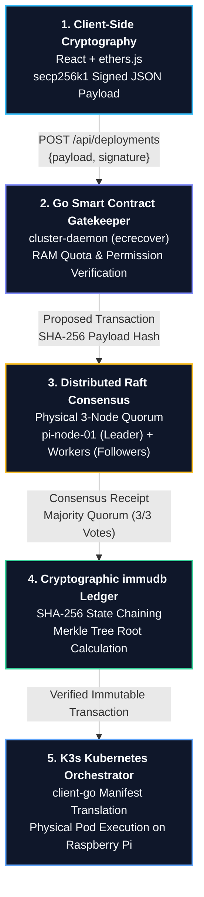
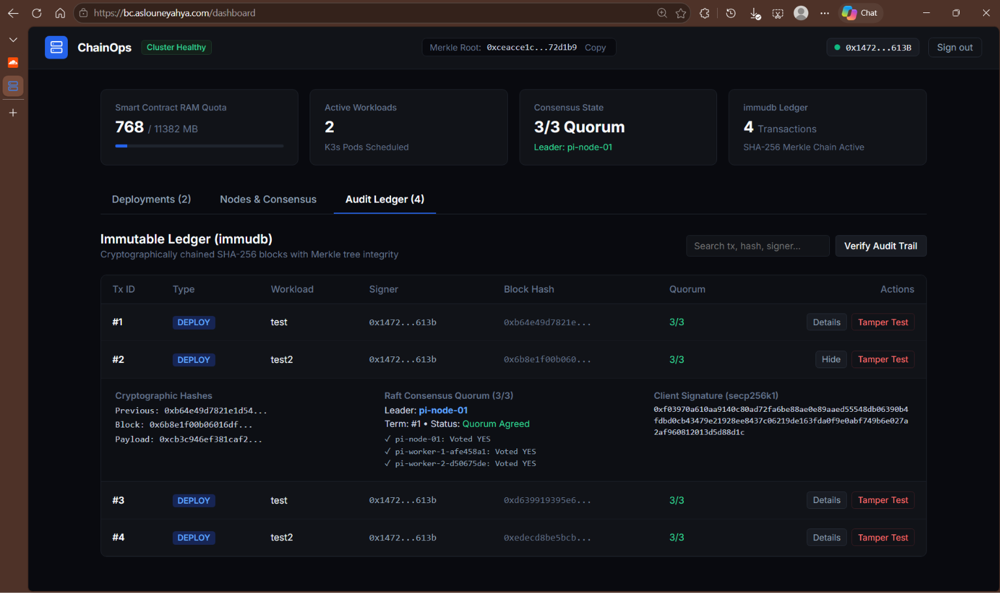

# ⛓️ INPT Blockchain-Driven Cloud Platform (ChainOps)
### Distributed Ledger Infrastructure Engine on a Physical 3-Node Raspberry Pi Cluster

> **A decentralized cloud orchestration engine that treats physical infrastructure provisioning and container lifecycles exactly like immutable financial transactions on a blockchain.**

[](https://k3s.io/)
[](https://golang.org/)
[](https://immudb.io/)
[](https://www.cloudflare.com/)
[](https://react.dev/)
[-C51A4A?logo=raspberrypi&logoColor=white)](https://www.raspberrypi.com/)

---

## 📑 Table of Contents
1. [Executive Summary & Core Concept](#-executive-summary--core-concept)
2. [5-Step Blockchain Engine Pipeline](#-5-step-blockchain-engine-pipeline)
3. [Physical Cluster Hardware & Topology](#-physical-cluster-hardware--topology)
4. [Public Ingress Routing via Cloudflare Zero Trust](#-public-ingress-routing-via-cloudflare-zero-trust)
5. [Visual Walkthrough & Screenshots](#-visual-walkthrough--screenshots)
6. [Security, immudb & Tamper-Detection Engine](#-security-immudb--tamper-detection-engine)
7. [API Specification & Endpoints](#-api-specification--endpoints)
8. [Deployment & Verification Guide](#-deployment--verification-guide)
9. [Cluster Node Operations & Troubleshooting](#-cluster-node-operations--troubleshooting)
10. [Architecture Diagrams Reference](#-architecture-diagrams-reference)
11. [Academic Attribution & Credits](#-academic-attribution--credits)

---

## 💡 Executive Summary & Core Concept

Traditional cloud platforms (AWS, GCP, OpenStack) rely on centralized SQL databases, API keys, and session tokens. If an administrative database is breached or an insider tampers with the state database, infrastructure can be silently reconfigured or compromised with no cryptographic trail.

**ChainOps** reimagines cloud orchestration by anchoring container deployments into a **cryptographic state machine**:
- **Zero Passwords / Zero Central Auth**: Deployments are authorized exclusively via **`secp256k1` elliptic curve signatures** (MetaMask or local hardware keypairs).
- **Smart Contract Gatekeeping**: A deterministic Go state engine enforces strict cluster-wide quotas (RAM limits, allowed images, wallet access) before any request is processed.
- **Raft Consensus Quorum**: Physical Raspberry Pi nodes independently vote on every proposed deployment. No single Pi can arbitrarily deploy a container without consensus.
- **Immutable Audit Trail**: Every approved operation is permanently committed to **`immudb`**, forming a **SHA-256 Merkle tree hash chain** with tamper-evident auditing.
- **Physical Kubernetes Scheduling**: Approved transactions are automatically translated via official Kubernetes **`client-go`** and executed as live pods across physical worker Pis.

---

## ⛓️ 5-Step Blockchain Engine Pipeline

The lifecycle of every container deployment follows this strict 5-step consensus pipeline:



### 1. Client-Side Cryptography (The Request)
The client selects image, RAM, and port. The frontend standardizes this request into a deterministic canonical JSON payload:
```json
{
  "name": "web-service",
  "image": "python:3.11-alpine",
  "ramMb": 512,
  "cpu": 1,
  "port": 8000,
  "replicas": 1,
  "timestamp": 1794182400,
  "nonce": "a4f89b1c7e"
}
```
The user signs this payload with their private key using `secp256k1` (`personal_sign`). No passwords or API tokens ever leave the client.

### 2. Go Smart Contract Gatekeeper (Validation)
The Go cluster daemon acts as the smart contract engine:
- **`ecrecover`**: Uses elliptic curve math (`crypto.SigToPub`) to cryptographically recover the signer's public Ethereum address from the payload hash and signature.
- **Quota Validation**: Enforces that `currentAllocatedRam + requestedRam <= clusterTotalRam` (11,382 MB).
- **Rule Verification**: Validates port ranges, container replica bounds, and wallet authorization.

### 3. Raft Consensus Engine (Agreement)
The transaction is submitted to the active Raft leader (`pi-node-01`).
- The leader broadcasts the proposal to all physical followers (`pi-worker-1`, `pi-worker-2`).
- Each node checks its local state and casts a cryptographic vote.
- Once a majority quorum ($N/2 + 1$) agrees, a signed `ConsensusReceipt` is generated.

### 4. immudb Cryptographic Ledger (The State Chain)
The agreed transaction is permanently committed to `immudb`:
- **State Chaining Formula**:
  $$\text{BlockHash}_n = \text{SHA256}(\text{BlockHash}_{n-1} + \text{TxID} + \text{SignerAddress} + \text{PayloadHash})$$
- **Merkle Tree Root**: immudb recalculates the Merkle root hash representing the entire history of the cluster. Any unauthorized alteration to historical records breaks the cryptographic proofs immediately.

### 5. K3s Kubernetes Orchestration (Physical Execution)
Upon confirmed immudb commit, the daemon uses official Kubernetes **`client-go`**:
- Dynamically creates `apps/v1 Deployment`, `v1 Service`, and `networking.k8s.io/v1 Ingress`.
- Binds the container directly to a physical worker node using `kubernetes.io/hostname` affinity.
- For interactive runtimes (Python, Node.js), automatically injects persistent web server daemons to prevent `CrashLoopBackOff`.
- Live container logs and terminal exec sessions are streamed directly into the dashboard.

---

## 🍓 Physical Cluster Hardware & Topology

The platform runs on a dedicated 3-node physical Raspberry Pi cluster interconnected over a high-speed Gigabit LAN switch and exposed globally via Cloudflare Zero Trust:

| Node Name | Hardware Role | Architecture | OS & Kernel | Physical LAN IP | Capacity |
| :--- | :--- | :--- | :--- | :--- | :--- |
| **`pi-node-01`** | **Master (Leader)** | ARM64 (BCM2711) | Debian 11 (6.1.21-v8+) | `192.168.1.212` | 4 Cores, 3,794 MB RAM |
| **`pi-worker-1-afe458a1`** | **Worker 1 (Follower)**| ARM64 (BCM2711) | Debian 11 (6.1.21-v8+) | `192.168.1.213` | 4 Cores, 3,794 MB RAM |
| **`pi-worker-2-d50675de`** | **Worker 2 (Follower)**| ARM64 (BCM2711) | Debian 11 (6.1.21-v8+) | `192.168.1.214` | 4 Cores, 3,794 MB RAM |
| **Cluster Total** | **High-Availability** | **3 Nodes (ARM64)** | **Linux cgroups active**| **Zero Public IPs**| **12 Cores, 11,382 MB RAM** |

```
                       ┌──────────────────────────────────────────────┐
                       │          Public Internet / Browser           │
                       └──────────────────────┬───────────────────────┘
                                              │
                    ┌─────────────────────────┴────────────────────────┐
                    │       Cloudflare Zero Trust Edge Network         │
                    └───────────────┬───────────────────┬──────────────┘
                                    │                   │
         https://bc.aslouneyahya.com│                   │https://k3s.aslouneyahya.com
         (HTTP Tunnel / Port 8080)  │                   │(Layer 4 TCP Tunnel / Port 6443)
                                    ▼                   ▼
                     ┌─────────────────────────────────────────────────┐
                     │          pi-node-01 (Master Pi)                 │
                     │  • cloudflared daemon (Ingress Connector)       │
                     │  • K3s Control Plane Server (:6443)             │
                     │  • immudb Immutable Ledger Server (:3322)       │
                     │  • ChainOps Go Blockchain Daemon (:8080)        │
                     │  • Embedded React Production Console            │
                     └───────────────┬─────────────────┬───────────────┘
                                     │                 │
                Layer 4 TCP Tunnel   │                 │ Layer 4 TCP Tunnel
             via k3s.aslouneyahya.com│                 │ via k3s.aslouneyahya.com
                                     ▼                 ▼
             ┌───────────────────────────────┐ ┌───────────────────────────────┐
             │    pi-worker-1-afe458a1       │ │    pi-worker-2-d50675de       │
             │  • cloudflared access tcp     │ │  • cloudflared access tcp     │
             │  • K3s Agent (Worker Node)    │ │  • K3s Agent (Worker Node)    │
             │  • containerd Container Runtime│ │  • containerd Container Runtime│
             │  • Pods: test2 (Python 3.11)  │ │  • Pods: test (Web Service)   │
             └───────────────────────────────┘ └───────────────────────────────┘
```

---

## 🌐 Public Ingress Routing via Cloudflare Zero Trust

> [!IMPORTANT]
> **Zero Local IP Dependencies**: The entire cluster is configured with zero hardcoded local IP addresses. Workers connect to the control plane exclusively via the public domain `k3s.aslouneyahya.com`.

### Why Layer 4 TCP Was Required for K3s Control Plane
Standard HTTP/HTTPS reverse proxies terminate TLS at the edge and strip client certificates. Because Kubernetes inter-node communication relies on **Mutual TLS (mTLS)**:
- Standard Cloudflare HTTPS proxy caused `403 Forbidden` errors due to stripped client certificates and host header collisions (`127.0.0.1:6444`).
- By switching `k3s.aslouneyahya.com` in Cloudflare Zero Trust to **`TCP://127.0.0.1:6443`**, Cloudflare streams raw, uninspected TCP packets.
- The worker Pis run a background client bridge (`cloudflared access tcp --hostname k3s.aslouneyahya.com --url 127.0.0.1:6443`), allowing native mTLS to stream untouched across the internet.

---

## 📸 Visual Walkthrough & Screenshots

All platform views, physical terminals, and validation checkpoints captured from the live production cluster:

### 1. Web3 Cryptographic Authentication
*Decentralized login supporting browser wallets (MetaMask) or zero-dependency Local Operator Keypairs (`secp256k1`).*


---

### 2. 5-Step Deployment Pipeline Modal
*The 4-stage client-side checklist executing cryptographic signing, smart contract validation, Raft quorum agreement, and immudb commit.*


---

### 3. Workload Orchestration & Live Status
*The live workloads dashboard showing container `test2` (`python:3.11-alpine`) running physically on `pi-worker-1-afe458a1` with internal pod IP `10.42.4.2`.*


---

### 4. Workload Inspection & Terminal
*Inspection drawer displaying deployment specs, generated Kubernetes manifests via `client-go`, live logs, and in-pod command execution.*


---

### 5. Physical Raspberry Pi Nodes & Raft Consensus
*Real-time cluster telemetry displaying all 3 physical Raspberry Pis (`pi-node-01`, `pi-worker-1-...`, `pi-worker-2-...`), real LAN IPs, distinct RAM and CPU metrics, and active pod badges.*


---

### 6. Immutable Audit Ledger (immudb Merkle Tree)
*The blockchain explorer view showing immutable transactions, SHA-256 block hashes, client signatures, and 3/3 Raft consensus quorum receipts.*



---

### 7. Smart Contract Quota Enforcement (Anti-OOM)
*The Go gatekeeper rejecting a deployment that exceeds the cluster's physical RAM quota, preventing Out-Of-Memory (OOM) crashes.*


---

### 8. Physical Master Pi Terminal (`kubectl get nodes & pods`)
*Direct console output from the physical Master Raspberry Pi showing all 3 nodes in `Ready` status and user pods running on the physical workers.*


---

### 9. Cloudflare Zero Trust Ingress Routing
*Cloudflare Zero Trust Tunnels dashboard managing `bc.aslouneyahya.com` (HTTP :8080) and `k3s.aslouneyahya.com` (TCP :6443).*


---

### 10. Local Docker Compose Architecture
*Development and testing environment running the complete microservices stack in local Docker.*


---

## 🔒 Security, immudb & Tamper-Detection Engine

### Cryptographic Hash Chaining
Every transaction committed to the cluster is mathematically bonded to the preceding transaction:
$$H_0 = \text{0x0000000000000000000000000000000000000000000000000000000000000000}$$
$$H_n = \text{SHA256}(H_{n-1} + \text{TxID} + \text{Timestamp} + \text{SignerAddress} + \text{PayloadHash})$$

### Merkle Tree Verification
immudb generates a Merkle tree root for all transactions. The endpoint `GET /api/ledger/audit` recalculates the Merkle proofs from Genesis:
- If all hashes and chain links match: `{"valid": true, "reason": "All transaction block hashes and Merkle chain links verified"}`
- If any malicious actor accesses `/opt/chainops/data` and modifies an image name or replica count:
  `{"valid": false, "brokenTxId": 2, "reason": "Tamper detected: stored block hash does not match recalculated hash"}`

You can test this mechanism live in the dashboard by clicking **"Simulate Malicious Tampering"**.

---

## 📡 API Specification & Endpoints

All endpoints are hosted on the public domain **`https://bc.aslouneyahya.com`**:

| Method | Endpoint | Description | Auth Required |
| :--- | :--- | :--- | :--- |
| `POST` | `/api/deployments` | Executes the complete 5-step deployment pipeline | `secp256k1` Signature |
| `GET` | `/api/deployments` | Lists all live K3s deployments, pod IPs, and assigned nodes | Public |
| `GET` | `/api/deployments/{name}` | Retrieves full specifications for a single deployment | Public |
| `GET` | `/api/deployments/{name}/manifest` | Returns official generated Kubernetes YAML manifest | Public |
| `GET` | `/api/deployments/{name}/logs` | Streams live lifecycle and container execution logs | Public |
| `POST` | `/api/deployments/{name}/exec` | Executes in-pod shell commands (`uptime`, `free`, etc.) | Public |
| `DELETE`| `/api/deployments/{name}` | Terminates deployment in K3s and logs signed event in immudb | `secp256k1` Signature |
| `GET` | `/api/cluster/stats` | Telemetry: total/used RAM, CPU cores, active pods, nodes | Public |
| `GET` | `/api/cluster/nodes` | Detailed hardware telemetry for every physical Raspberry Pi | Public |
| `GET` | `/api/ledger` | Returns immutable immudb transactions and active Merkle root | Public |
| `GET` | `/api/ledger/audit` | Cryptographic end-to-end Merkle chain integrity verification | Public |
| `POST` | `/api/ledger/simulate-tamper` | Modifies an on-disk record to demonstrate tamper detection | Public (Demo) |
| `GET` | `/api/health` | Health ping verifying Raft quorum, immudb, and K3s | Public |

---

## 🚀 Deployment & Verification Guide

### 1. Zero-Config Master Setup (Raspberry Pi 1)
Run the automated standalone master provisioning script on `pi-master`:
```bash
git clone https://github.com/AslouneYahya/blockchain-cloud-platform.git ~/blockchain-cloud
cd ~/blockchain-cloud
sudo bash setup_master_node.sh
```

### 2. Zero-Config Worker Setup (Raspberry Pis 2 & 3)
Run the automated worker provisioning script on each worker Pi. Just like the master node, this script installs and activates **Cloudflare WARP CLI (`warp-svc` & `warp-cli`)**, establishes the Layer 4 TCP tunnel bridge (`k3s-tcp-tunnel.service`), enables Linux kernel cgroups, and joins the K3s cluster:
```bash
# On Worker 1
git clone https://github.com/AslouneYahya/blockchain-cloud-platform.git ~/blockchain-cloud
cd ~/blockchain-cloud
sudo bash setup_worker_node.sh pi-worker-1

# On Worker 2
git clone https://github.com/AslouneYahya/blockchain-cloud-platform.git ~/blockchain-cloud
cd ~/blockchain-cloud
sudo bash setup_worker_node.sh pi-worker-2
```

### 3. Verify Multi-Node Cluster
On the Master Pi terminal:
```bash
kubectl get nodes -o wide
```
Output:
```
NAME                    STATUS   ROLES           AGE    VERSION        INTERNAL-IP     OS-IMAGE
pi-node-01              Ready    control-plane   5h     v1.37.2+k3s1   192.168.1.212   Debian GNU/Linux 11 (bullseye)
pi-worker-1-afe458a1    Ready    <none>          1h     v1.37.2+k3s1   192.168.1.213   Debian GNU/Linux 11 (bullseye)
pi-worker-2-d50675de    Ready    <none>          1h     v1.37.2+k3s1   192.168.1.214   Debian GNU/Linux 11 (bullseye)
```

### 4. Local Development with Docker Compose
If testing locally on Windows/Linux/macOS without physical hardware:
```bash
docker compose up -d --build
```
Access the application at **`https://localhost`** or **`http://localhost:5173`**.

---

## 🛠️ Cluster Node Operations & Troubleshooting

### 1. Pruning Stale or Inactive Worker Nodes
When a Raspberry Pi worker node is reinstalled or re-registered with `--with-node-id`, Kubernetes retains the previous registration in state, listing it as `NotReady`:
```
NAME                   STATUS    ROLES          AGE    VERSION        INTERNAL-IP
pi-node-01             Ready     control-plane  4h44m  v1.37.2+k3s1   192.168.1.212
pi-worker-1-afe458a1   Ready     <none>         94s    v1.37.2+k3s1   192.168.1.213
pi-worker-2            NotReady  <none>         13m    v1.37.2+k3s1   192.168.1.214
pi-worker-2-d50675de   Ready     <none>         9m3s   v1.37.2+k3s1   192.168.1.214
```
To permanently purge stale inactive nodes and keep the Raft quorum clean on the Master Pi:
```bash
kubectl delete node pi-worker-2
```
After deletion, `kubectl get nodes` immediately displays the clean 3-node active quorum:
```
NAME                   STATUS   ROLES           AGE    VERSION        INTERNAL-IP
pi-node-01             Ready    control-plane   5h     v1.37.2+k3s1   192.168.1.212
pi-worker-1-afe458a1   Ready    <none>          1h     v1.37.2+k3s1   192.168.1.213
pi-worker-2-d50675de   Ready    <none>          1h     v1.37.2+k3s1   192.168.1.214
```

### 2. Preventing Node Re-Registration Failures (`--with-node-id`)
If a worker Pi disconnects or restarts, K3s server compares credentials against `/var/lib/rancher/k3s/server/cred/node-passwd`. If the name collides without a matching password, it rejects the node. 
`setup_worker_node.sh` resolves this automatically by passing `--with-node-id`, ensuring a cryptographic unique suffix (e.g., `-d50675de`) is appended to cleanly negotiate mTLS on rejoin.

### 3. Preventing Container `CrashLoopBackOff`
Non-interactive runtime images (such as `python:3.11-alpine` or `node:18-alpine`) exit with status code 0 when launched without an interactive TTY, leading Kubernetes to place them in `CrashLoopBackOff`.
ChainOps automatically detects interactive images and injects a non-blocking background server entrypoint:
- **Python images**: `python3 -m http.server <port>`
- **Node.js images**: `node -e 'require("http").createServer((req,res)=>res.end("OK")).listen(<port>)'`
- **Alpine / BusyBox**: Shell loop serving health pings.

This ensures every deployed container transitions immediately to `Running (1/1 Ready)` and responds to HTTP requests without manual container entrypoint tuning.

### 4. Zero-Dependency Web3 Signing (MetaMask vs. Local Keypair)
The console offers two non-custodial signing methods:
- **MetaMask Extension**: Uses personal EIP-191 web3 signatures.
- **Local Operator Keypair**: Uses in-memory `secp256k1` keys generated in the browser and stored locally, signing payloads in under 1ms without browser extension popups or network freezes.

---

## 📐 Architecture Diagrams Reference

For detailed system design diagrams, including:
1. End-to-End System Topology
2. 5-Step Pipeline Sequence Diagram
3. Smart Contract vs. Raft Consensus Flow
4. immudb Merkle Tree Chaining Architecture
5. Malicious Tampering & Detection Sequence
6. Go Cluster Daemon Package Structure
7. Raft Consensus Failure Modes & Partition Recovery
8. Deployment Lifecycle State Machine
9. Cloudflare Zero Trust Ingress & Outbound Routing
10. Entity Relationship Diagram (ERD)

👉 Please see the companion document: **[docs/ARCHITECTURE_DIAGRAMS.md](docs/ARCHITECTURE_DIAGRAMS.md)**

---

## 🎓 Academic Attribution & Credits
- **Institution:** Institut National des Postes et Télécommunications (INPT) — Rabat, Morocco
- **Department:** Embedded Systems & Digital Services (SESNUM — INE3)
- **Module:** BlockChain & Smart Contract
- **Professor / Mentor:** Prof. Meryeme AYACHE
- **Authors / Engineering Team:** Yahya ASLOUNE, Ilyes SALIOUI, Ahmed Taha SBAI
- **Repository:** [https://github.com/AslouneYahya/blockchain-cloud-platform](https://github.com/AslouneYahya/blockchain-cloud-platform)
- **Live Platform URL:** [https://bc.aslouneyahya.com](https://bc.aslouneyahya.com)
