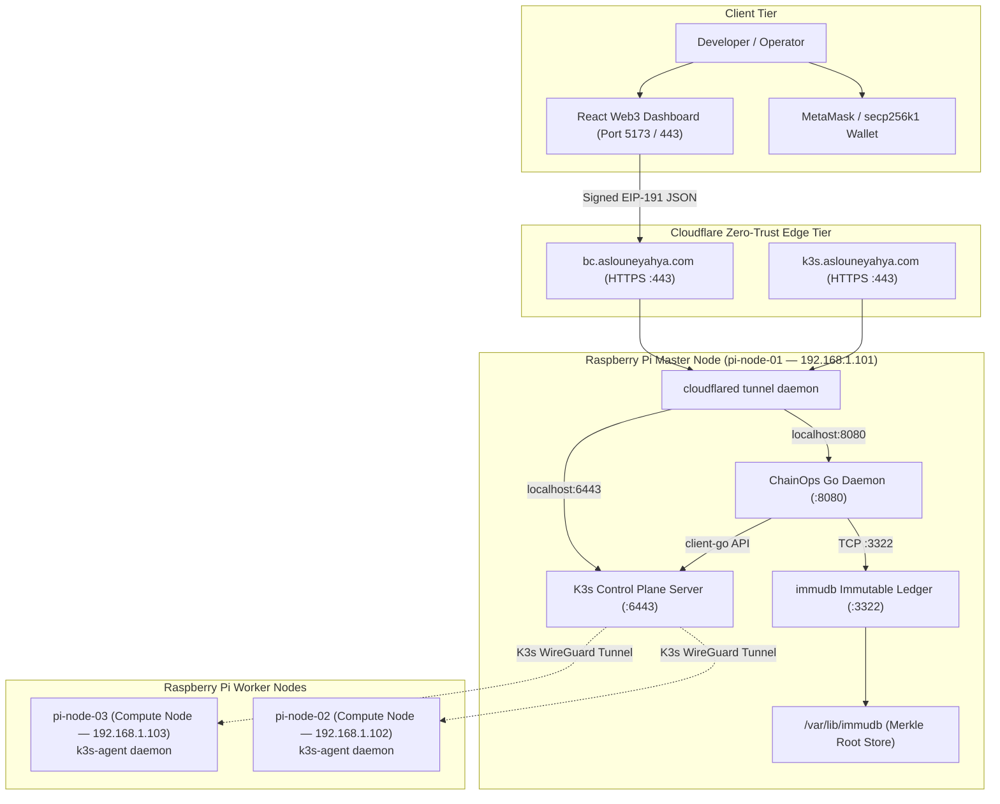
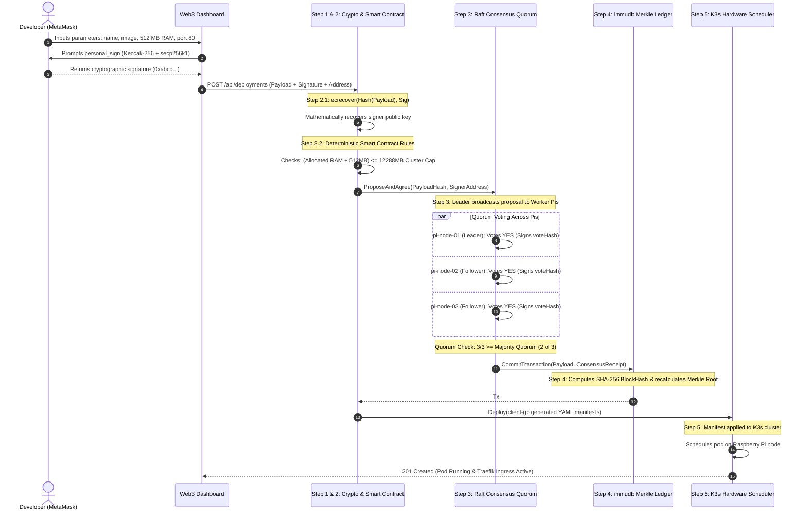
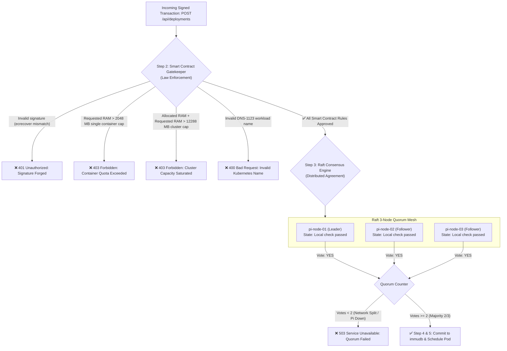
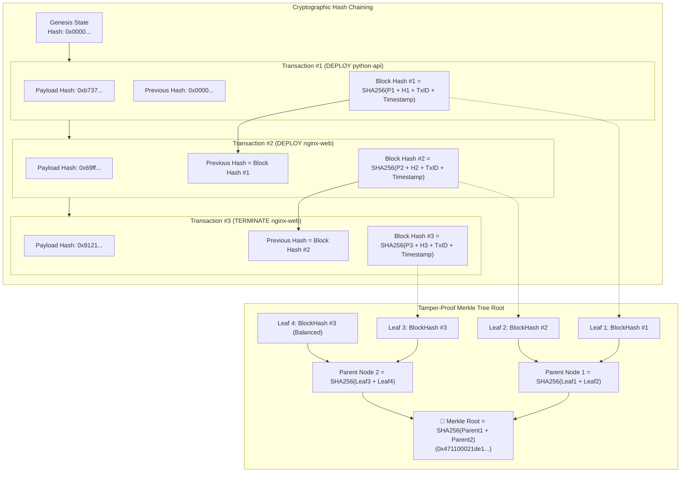
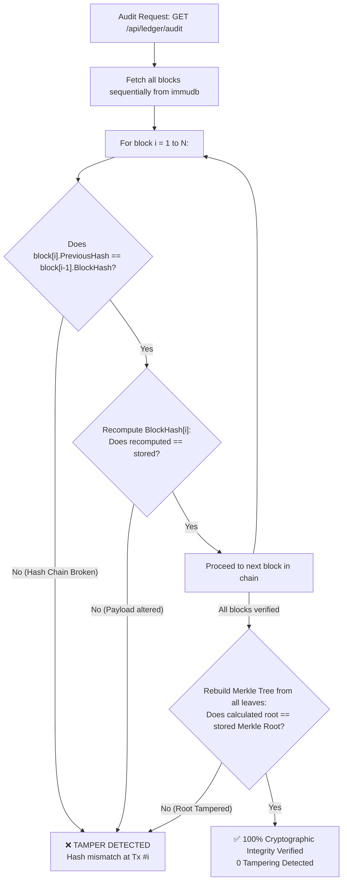
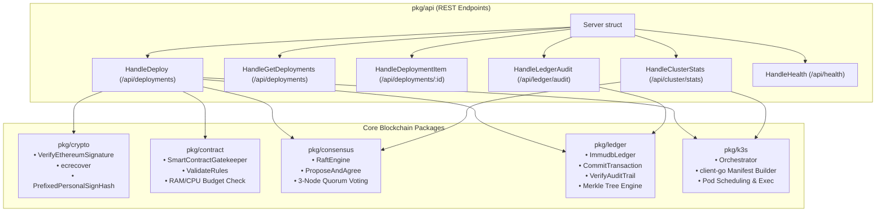
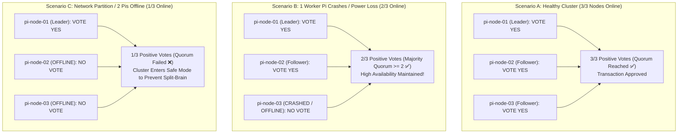
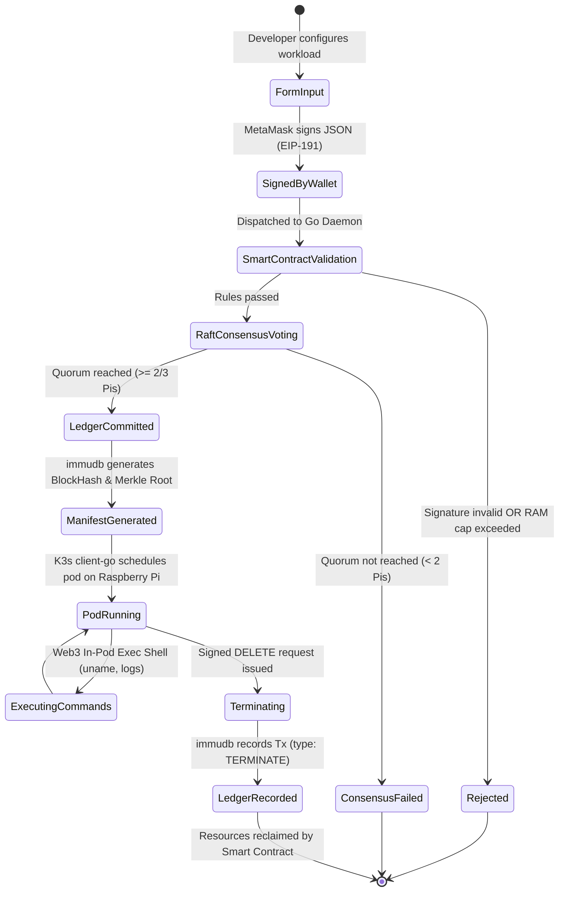
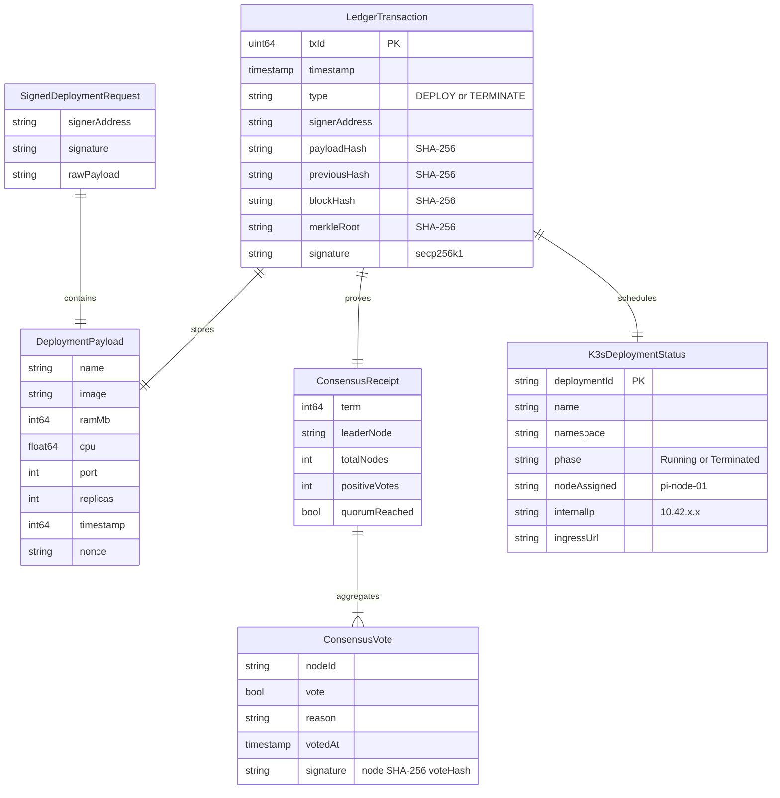

# Blockchain-Driven Cloud Infrastructure — Architecture & Technical Diagrams

This document contains the complete architectural, cryptographic, and operational diagrams for the **ChainOps Blockchain Cloud Platform**, deployed on a 3-node physical Raspberry Pi cluster with K3s and immudb.

All diagrams are written in **Mermaid** and render automatically in GitHub, VS Code, and Markdown viewers.

---

## Table of Contents
1. [End-to-End System Topology (Physical Hardware & Cloudflare Edge)](#1-end-to-end-system-topology)
2. [The 5-Step Blockchain Execution Pipeline](#2-the-5-step-blockchain-execution-pipeline)
3. [Smart Contract Gatekeeper vs. Raft Consensus Voting](#3-smart-contract-gatekeeper-vs-raft-consensus-voting)
4. [immudb SHA-256 State Chaining & Merkle Tree Integrity](#4-immudb-sha-256-state-chaining--merkle-tree-integrity)
5. [Tamper Detection & Audit Verification Workflow](#5-tamper-detection--audit-verification-workflow)
6. [Go Cluster Daemon Internal Package Architecture](#6-go-cluster-daemon-internal-package-architecture)
7. [Raft Quorum Voting & Fault Tolerance Scenarios](#7-raft-quorum-voting--fault-tolerance-scenarios)
8. [Workload Lifecycle State Machine](#8-workload-lifecycle-state-machine)
9. [Network Routing & Ingress Flow](#9-network-routing--ingress-flow)
10. [Data Model & Ledger Transaction Schema (ERD)](#10-data-model--ledger-transaction-schema)

---

## 1. End-to-End System Topology

---

## 2. The 5-Step Blockchain Execution Pipeline

---

## 3. Smart Contract Gatekeeper vs. Raft Consensus Voting

---

## 4. immudb SHA-256 State Chaining & Merkle Tree Integrity

---

## 5. Tamper Detection & Audit Verification Workflow

---

## 6. Go Cluster Daemon Internal Package Architecture

---

## 7. Raft Quorum Voting & Fault Tolerance Scenarios

---

## 8. Workload Lifecycle State Machine

---

## 9. Network Routing & Ingress Flow

```mermaid
graph LR
    subgraph External["Public Internet"]
        Browser["User Browser"]
    end

    subgraph CloudflareEdge["Cloudflare Edge Network"]
        CF_Dns["Cloudflare DNS & SSL Termination"]
        CF_Tunnel["Cloudflare Edge Tunnel Connector"]
        CF_Dns --> CF_Tunnel
    end

    Browser -->|https://bc.aslouneyahya.com| CF_Dns
    Browser -->|https://k3s.aslouneyahya.com| CF_Dns

    subgraph MasterHardware["Raspberry Pi Master Hardware"]
        TunnelDaemon["cloudflared process"]
        GoAPI["Go Daemon (:8080)"]
        K3sAPI["K3s API Server (:6443)"]
        Traefik["Traefik Ingress Controller (:80)"]
        Pod1["Pod: python-backend (10.42.10.52:8000)"]

        CF_Tunnel -->|Encrypted Tunnel| TunnelDaemon
        TunnelDaemon -->|HTTP :8080| GoAPI
        TunnelDaemon -->|HTTPS :6443| K3sAPI
        GoAPI -.->|client-go API| K3sAPI
        K3sAPI -.->|Routes Traffic| Traefik
        Traefik -->|Internal Pod IP| Pod1
    end
```

---

## 10. Data Model & Ledger Transaction Schema

